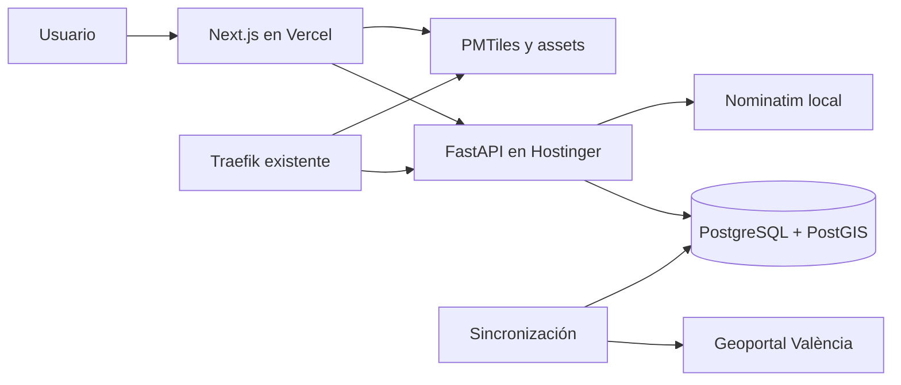

# Aparca València

Aplicación web mobile-first para localizar zonas documentadas de aparcamiento no regulado cerca de un destino en València.

> Mostramos zonas de aparcamiento no regulado según datos municipales. La disponibilidad de plazas no está confirmada. Comprueba siempre la señalización.

## Arquitectura

- `apps/web`: Next.js, React, TypeScript, Tailwind, MapLibre y TanStack Query.
- `services/api`: FastAPI, SQLAlchemy asíncrono, PostGIS, Alembic e importadores municipales.
- `infra`: proxy estático para PMTiles, tareas programadas y despliegue.
- `docs`: arquitectura, fuentes, API, recomendaciones y operación.



## Desarrollo local

Requisitos: Node.js 22, pnpm 10 y Docker Desktop.

```bash
cp .env.example .env
pnpm install
docker compose up -d db api map-assets
docker compose run --rm api alembic upgrade head
pnpm dev
```

Frontend: `http://localhost:3000`. API: `http://localhost:8000/docs`.

## Importación

```bash
docker compose run --rm api python -m app.cli sync-unregulated
docker compose run --rm api python -m app.cli sync-regulated --horizon 1
```

La segunda orden solo funciona cuando `ENABLE_REGULATED_PREDICTIONS=true`.

## Comprobaciones

```bash
pnpm check
docker compose run --rm api ruff check .
docker compose run --rm api pytest
pnpm test:e2e
```

Consulta [docs/deployment.md](docs/deployment.md) para publicación y copias de seguridad.

## Fuentes y licencia

Los datos municipales pertenecen al Ajuntament de València y se reutilizan bajo CC BY 4.0. La cartografía base deriva de OpenStreetMap y Protomaps. El código de este repositorio se distribuye bajo licencia MIT; las licencias de los datos no cambian.
