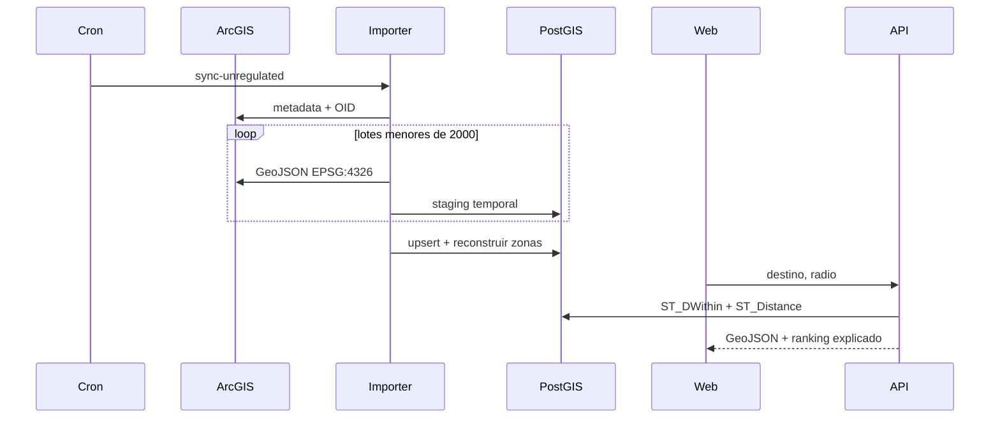

# Arquitectura

## Decisiones principales

- Monorepositorio sin orquestador adicional: pnpm para web y un único monolito modular FastAPI.
- PostgreSQL/PostGIS es la fuente de verdad geográfica; el navegador nunca descarga el inventario completo.
- `parking_features` conserva cada geometría municipal. `parking_zones` es una proyección reconstruible para búsqueda y presentación.
- La importación completa usa una tabla temporal y solo fusiona al terminar y conciliar todos los OID.
- Nominatim utiliza otra base lógica del mismo clúster PostgreSQL y solo es accesible desde la red Docker interna.
- PMTiles, fuentes y sprites se sirven como archivos estáticos con soporte HTTP Range.

## Flujo de datos

## Privacidad y seguridad

- CORS restringido, límites de respuesta y rate limiting por IP en una única instancia.
- Logs estructurados sin parámetros de consulta, direcciones ni coordenadas.
- PostgreSQL y Nominatim no publican puertos en producción.
- Ningún secreto se incluye en Git; producción consume `.env` únicamente en el VPS.
